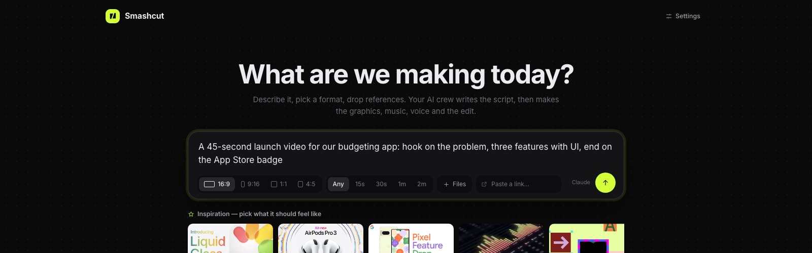
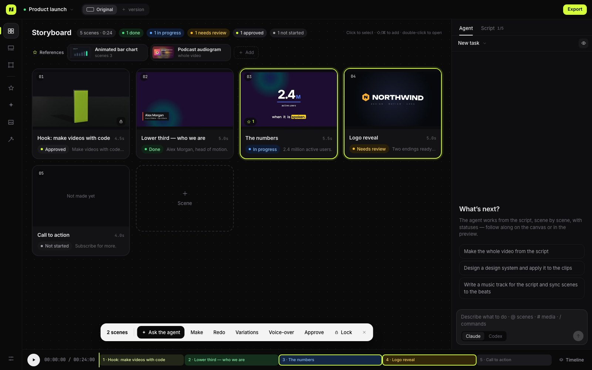
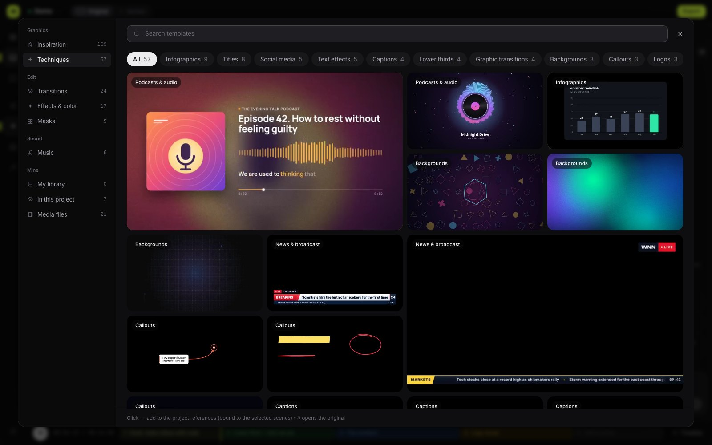
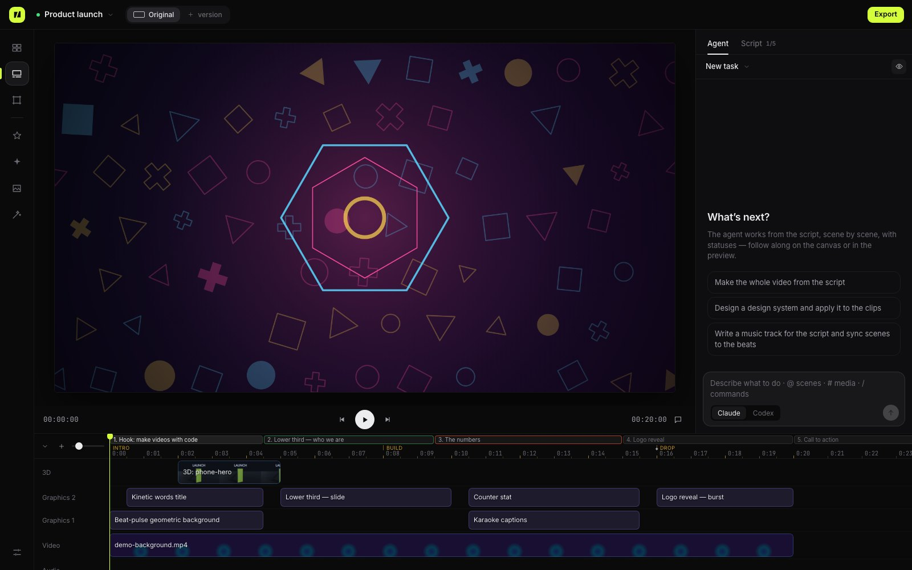

<p align="center">
  
</p>

<h1 align="center">Smashcut — the open-source AI video production studio</h1>

<p align="center">
  <b>Your AI crew makes the video. You direct.</b><br>
  Claude Code and Codex agents write the script, then make the motion graphics, music, voice-over, 3D shots and the edit — as code you can open, version and change.
</p>

<p align="center">
  <a href="https://www.npmjs.com/package/smashcut-studio"></a>
  <a href="LICENSE"></a>
  
  
</p>

<p align="center">
  <b>English</b> · <a href="README.ru.md">Русский</a> · <a href="README.zh-CN.md">简体中文</a> · <a href="https://legostin.github.io/smashcut/">Website</a>
</p>

<p align="center"></p>

## What is Smashcut?

Smashcut is a **local-first AI video editor** for motion graphics, explainers, product launches and social videos. Instead of generating pixels you can't edit, your AI agents (the [Claude Code](https://claude.com/claude-code) or Codex CLI you already use) build the video **as code**: every title, chart, transition and music cue is a small HTML/CSS/GSAP clip or a Tone.js score that renders frame-exact to MP4.

- **Storyboard first** — the agent writes the script (scenes, copy, timing, visuals) before it makes anything, then works scene by scene with live statuses.
- **Direct, don't regenerate** — "make the number bigger", "redo scene 3", "lock what I approved". Pin comments on frames; agents resolve them.
- **Everything a video needs** — motion graphics, music, voice-over, captions, 3D in Blender, footage tracking, editing and export.
- **Yours** — runs on your machine with your own agent subscription. Projects are plain folders with git history. MIT licensed.

## Install

Requirements: macOS or Linux, Node.js 20+, and at least one agent CLI you are logged into — Claude Code (`npm i -g @anthropic-ai/claude-code`) and/or Codex (`npm i -g @openai/codex`).

```sh
npx smashcut-studio                 # opens http://127.0.0.1:4317
# or install it
npm i -g smashcut-studio && smashcut ~/Videos/my-video

smashcut doctor                     # checks ffmpeg, render browser, agent logins, Blender, disk, port
```

ffmpeg is used from your system if present (bundled fallback otherwise). Rendering uses your installed Chrome or downloads Chrome Headless Shell once. Blender (optional) enables 3D scenes.

## Features



### Storyboard-first AI video production
The agent writes a script, then builds scene by scene. Every scene shows its status — not started, in progress, needs review, done, approved — and which agent is on it. Select scenes to **Make**, **Redo**, **Variations** or **Voice-over** them (you add what to change), **Approve** or **Lock** them — approved and locked scenes are off-limits for agents.

### Motion graphics as code
Clips are HTML/CSS/JS (GSAP, SVG, canvas) — pure functions of time, rendered frame-exact. Flexible parameters, design-system tokens, an on-frame layout gizmo, 24 transitions, 17 effects, masks and blend modes that render identically in preview and export.

### Professional craft built in
Agents follow a core **craft skill** distilled from measured references (HyperFrames films, BBC/Netflix subtitle specs, Material / Carbon / Fluent motion tokens, NN/g): story before frames, audio as the clock, one focal motion at a time, easing by role, read time and type sizes, safe areas for 9:16, seams between scenes, sound levels — and a review loop with contact sheets.

### Techniques, references and inspiration
57 built-in **techniques** (each with a guide the agent studies — not templates to paste) and **108 curated real-world motion pieces** from studios, product launches, code demos and social formats, each with a breakdown. Add them to a project as references, bound to scenes.



### Music, voice-over and sound
- **Music as code** — Tone.js scores rendered offline; beats, sections and markers drive the animation.
- **Voice-over as a process** — speech text with numbers spelled out, stress marks and pauses; ElevenLabs takes with a pace check so the voice doesn't speed up or slow down; captions keep the display text.
- Loudness normalisation, denoise, silence removal and music ducking.

### 3D: Three.js by default, Blender for the heavy stuff
- **Three.js clips** — logos and type extruded in space, product turntables, particles that form shapes, 3D charts, isometric scenes. Live in the preview (no render step), tweakable params, transparent over footage, frame-exact in export. Agents can install any npm package into the project and use it in a clip.
- **Blender** — physics, cloth and fluids, photoreal Cycles light, heavy geometry: Python scenes rendered headless in stages — **mock** (seconds) → **look** (EEVEE) → **final** — placed on the timeline and replaced in place.

### Footage tools for agents
Camera tracking (graphics glued to the world), planar tracking (screen replacement with perspective), object tracking by words, auto-reframe 16:9 → 9:16, blur faces/plates, background removal for images and video, chroma key, shot detection and rhythm analysis, morphs, slow-mo.



### Built for real work
Projects are git repositories (every agent task is a commit, undo/redo), several projects in browser tabs, video versions for other languages/aspect ratios/lengths, sub-agents that build scenes in parallel, agents isolated to the editor's tools by default, export to MP4 / ProRes 4444 with alpha / WebM / GIF, English UI with Russian and more.

## How does it compare?

| | Smashcut | Remotion | Higgsfield / video generators | ComfyUI | After Effects |
|---|---|---|---|---|---|
| Made by AI agents from a brief | **Yes** | You write React code | Prompt → clip | You build a node graph | Manual |
| Exact text, numbers, charts, logos | **Yes (code)** | Yes (code) | Often garbled | Hard | Yes |
| Edit one detail without regenerating | **Yes** | Yes | No | Partly | Yes |
| Whole video: script, music, voice, edit | **Yes** | DIY | Clips only | DIY | Manual |
| Photoreal footage generation | **Yes (fal.ai, Runway, Replicate, Higgsfield, OpenAI, Google, ComfyUI — your keys)** | No | **Yes** | **Yes** | No |
| Runs locally, your subscription | **Yes** | Yes | Cloud credits | Yes (GPU) | Subscription |
| Open source | **MIT** | Source-available license | No | GPL | No |

Smashcut is not a replacement for footage generators — it is the studio around them: agents call your footage generators (with a daily budget) and choose per scene between generating a shot and building it in code — then edit, track, caption and score it like any other footage.

## FAQ

**Is Smashcut free?** Yes — MIT licensed. It uses the Claude Code or Codex subscription you already have; optional services (ElevenLabs voice, video generators) use your own keys.

**Do I need to know how to code?** No. You describe the video and direct it in plain language; the agents write the code. Developers can open and edit everything.

**Can it make vertical videos for TikTok, Reels and Shorts?** Yes — 9:16, 1:1, 4:5 and 16:9, with platform safe areas, captions and versions per format.

**Is it a Remotion alternative?** It shares the idea that video is code, but Smashcut is a full editor where AI agents do the work: script, storyboard, timeline, music, voice-over, 3D, tracking and review.

**Does my footage leave my computer?** No. Everything runs locally; only your agent CLI talks to its provider, and optional services you configure.

## Use your own terminal agent

```sh
claude mcp add studio -e STUDIO_URL=http://127.0.0.1:4317 -- node "$(npm root -g)/smashcut-studio/server/mcp/stdio.mjs"
```

## Develop

```sh
git clone https://github.com/legostin/smashcut && cd smashcut
npm install
npm run dev        # server (tsx) + Vite
npm test           # end-to-end: templates, music, composite, MCP, export parity
npx tsx test/toolkit.ts
```

Contributions are welcome — open an issue to discuss bigger changes first.

## License

[MIT](LICENSE) · third-party notices in [ATTRIBUTIONS.md](ATTRIBUTIONS.md) when present.

<sub>Keywords: AI video editor, AI motion graphics, open-source video editor, Claude Code video, Codex agents, MCP video tools, explainer video maker, product launch video, text to video, AI storyboard, GSAP animation, Blender automation, video tracking, local-first.</sub>
