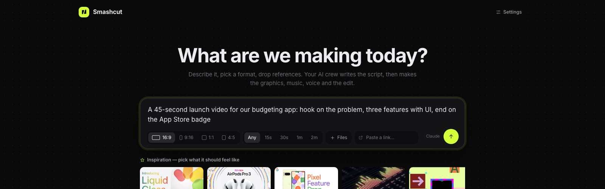
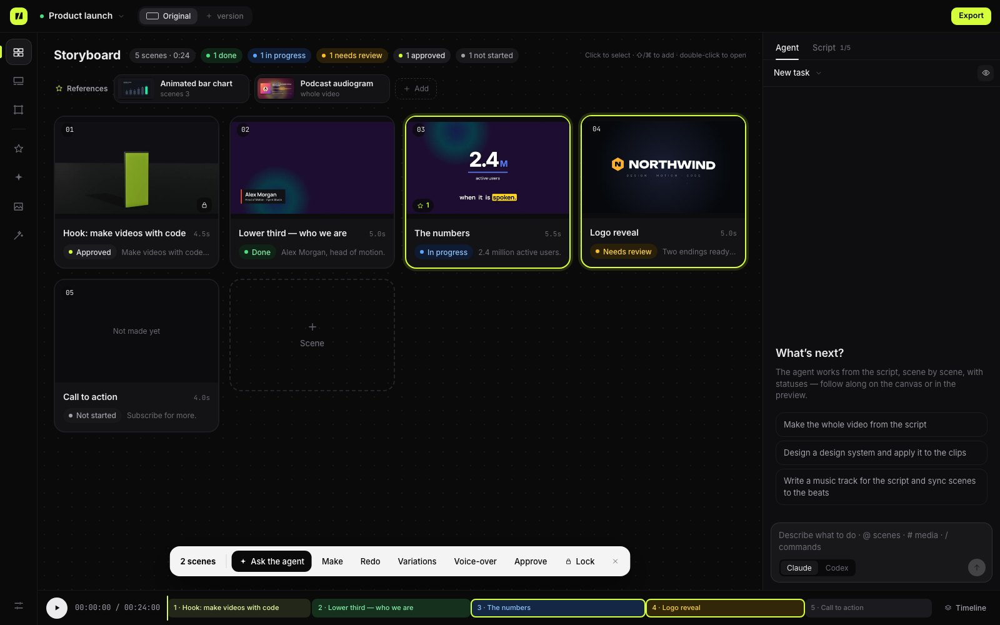
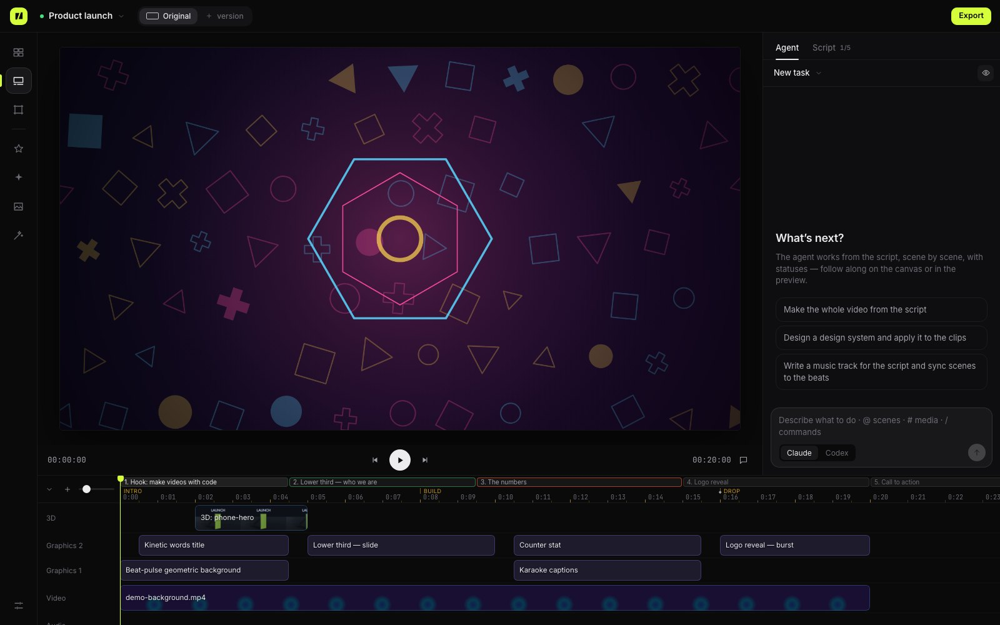

<p align="center">
  
</p>

<h1 align="center">Smashcut — AI-продакшн-студия видео с открытым кодом</h1>

<p align="center">
  <b>Ваша AI-команда делает ролик. Вы режиссируете.</b><br>
  Агенты Claude Code и Codex пишут сценарий, а потом делают моушн-графику, музыку, озвучку, 3D и монтаж — кодом, который можно открыть, версионировать и править.
</p>

<p align="center">
  <a href="https://www.npmjs.com/package/smashcut-studio"></a>
  <a href="LICENSE"></a>
  
</p>

<p align="center">
  <a href="README.md">English</a> · <b>Русский</b> · <a href="README.zh-CN.md">简体中文</a> · <a href="https://legostin.github.io/smashcut/">Сайт</a>
</p>

<p align="center"></p>

## Что такое Smashcut

Smashcut — **локальный AI-видеоредактор** для моушн-графики, объясняющих роликов, запусков продуктов и видео для соцсетей. Вместо генерации пикселей, которые нельзя поправить, ваши агенты (Claude Code или Codex, которыми вы уже пользуетесь) собирают ролик **кодом**: каждый титр, график, переход и музыкальный акцент — это небольшой клип на HTML/CSS/GSAP или партитура Tone.js, которые рендерятся в MP4 кадр в кадр.

- **Сначала сценарий** — агент пишет сценарий (сцены, текст, тайминг, визуал), а потом работает по сценам с живыми статусами.
- **Режиссируйте, а не перегенерируйте** — «цифру крупнее», «переделай сцену 3», «утверждённое не трогай». Комментарии прямо на кадрах, агенты их закрывают.
- **Всё, что нужно ролику** — графика, музыка, озвучка, субтитры, 3D в Blender, трекинг отснятого, монтаж и экспорт.
- **Ваше** — работает на вашем компьютере с вашей подпиской агента. Проекты — обычные папки с git-историей. Лицензия MIT.

## Установка

Нужны macOS или Linux, Node.js 20+ и хотя бы один CLI агента, в котором вы залогинены: Claude Code (`npm i -g @anthropic-ai/claude-code`) и/или Codex (`npm i -g @openai/codex`).

```sh
npx smashcut-studio                 # откроет http://127.0.0.1:4317
# или установить
npm i -g smashcut-studio && smashcut ~/Videos/my-video

smashcut doctor                     # проверит ffmpeg, браузер для рендера, входы агентов, Blender, диск, порт
```

## Возможности



- **Раскадровка со статусами.** Выделите сцены — «Сделать», «Переделать», «Вариации», «Озвучить» (допишите, что изменить), «Утвердить», «Заблокировать». Утверждённое и заблокированное агенты не трогают.
- **Моушн-графика кодом.** Клипы на HTML/CSS/JS — чистые функции времени. Гибкие параметры, токены дизайн-системы, гизмо прямо в кадре, 24 перехода, 17 эффектов, маски и режимы наложения — одинаково в превью и экспорте.
- **Ремесло встроено.** Агенты следуют правилам из проверенных источников (HyperFrames, субтитры BBC/Netflix, моушн-токены Material/Carbon/Fluent, NN/g): сначала история, звук задаёт время, одно движение за раз, изинги по ролям, время чтения и размеры текста, безопасные зоны 9:16, склейки, уровни звука и цикл проверки.
- **Приёмы, референсы, вдохновение.** 57 приёмов с руководствами (агент учится, а не копирует) и небольшая отобранная коллекция «Вдохновение» — лучшие реальные работы (титры, запуски продуктов, истории на данных, реклама, авторские форматы). У каждой одной строкой написано, что мы из неё берём, и это показано: наша зацикленная мини-сцена воспроизводит именно этот приём, а не саму работу. Добавляются в проект как референсы.
- **Музыка, озвучка, звук.** Музыка кодом на Tone.js; озвучка как процесс (числа словами, ударения, паузы, дубли с проверкой темпа); нормализация громкости, шумоподавление, вырезание тишины, приглушение музыки под голос.
- **3D: Three.js по умолчанию, Blender для сложного.** Three.js-клипы — логотипы и текст в объёме, товар на поворотном столе, частицы, собирающиеся в форму, 3D-графики — живут прямо в превью без рендера, правятся параметрами и ложатся поверх видео. Агент может поставить в проект любой npm-пакет. Blender — для физики, тканей и жидкостей, фотореализма и тяжёлой геометрии: мок за секунды → лукдев (EEVEE) → финал.
- **Инструменты для отснятого.** Трекинг камеры, плоскостей (замена экранов с перспективой) и объектов по словам, автокадрирование 16:9 → 9:16, размытие лиц и номеров, удаление фона, кеинг, поиск склеек и анализ ритма, морфинг, слоумо.
- **Для реальной работы.** Git-история (каждая задача агента — коммит, отмена/повтор), несколько проектов во вкладках, версии ролика на другие языки и форматы, сабагенты, изоляция агентов, экспорт в MP4 / ProRes 4444 с альфой / WebM / GIF.



## Сравнение

| | Smashcut | Remotion | Higgsfield и генераторы видео | ComfyUI | After Effects |
|---|---|---|---|---|---|
| Делают AI-агенты по брифу | **Да** | Вы пишете код на React | Промпт → клип | Вы собираете граф | Вручную |
| Точный текст, цифры, графики, логотипы | **Да (код)** | Да (код) | Часто «каша» | Сложно | Да |
| Правка детали без перегенерации | **Да** | Да | Нет | Частично | Да |
| Ролик целиком: сценарий, музыка, голос, монтаж | **Да** | Сами | Только клипы | Сами | Вручную |
| Фотореалистичная генерация съёмки | **Да (fal.ai, Runway, Replicate, Higgsfield, OpenAI, Google, ComfyUI — по вашим ключам)** | Нет | **Да** | **Да** | Нет |
| Локально, на вашей подписке | **Да** | Да | Облачные кредиты | Да (нужна GPU) | Подписка |
| Открытый код | **MIT** | Source-available | Нет | GPL | Нет |

## Вопросы

**Это бесплатно?** Да, MIT. Используется ваша подписка Claude Code или Codex; ElevenLabs и генераторы видео — по вашим ключам, по желанию.

**Нужно уметь программировать?** Нет. Вы описываете ролик и правите словами, код пишут агенты.

**Можно вертикальные видео для TikTok, Reels и Shorts?** Да: 9:16, 1:1, 4:5 и 16:9, с безопасными зонами платформ, субтитрами и версиями под каждый формат.

**Мои материалы куда-то уходят?** Нет, всё работает локально.

## Разработка

```sh
git clone https://github.com/legostin/smashcut && cd smashcut
npm install
npm run dev
npm test
```

Лицензия [MIT](LICENSE).
