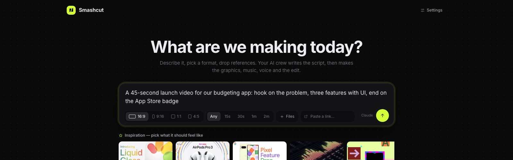
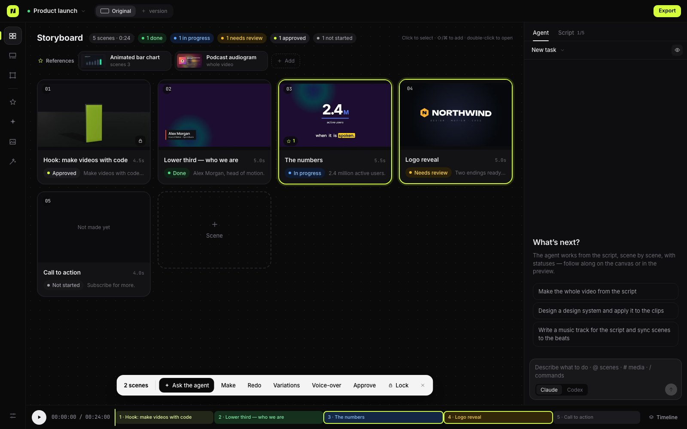
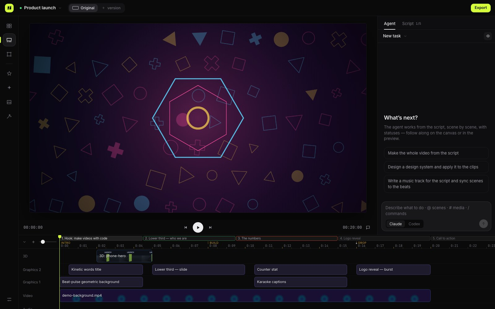

<p align="center">
  
</p>

<h1 align="center">Smashcut — 开源 AI 视频制作工作室</h1>

<p align="center">
  <b>你的 AI 团队负责制作，你来当导演。</b><br>
  Claude Code 与 Codex 智能体先写脚本，再制作动态图形、音乐、配音、3D 镜头和剪辑——全部以代码形式呈现，可打开、可版本管理、可随时修改。
</p>

<p align="center">
  <a href="https://www.npmjs.com/package/smashcut-studio"></a>
  <a href="LICENSE"></a>
  
</p>

<p align="center">
  <a href="README.md">English</a> · <a href="README.ru.md">Русский</a> · <b>简体中文</b> · <a href="https://legostin.github.io/smashcut/">官网</a>
</p>

<p align="center"></p>

## Smashcut 是什么？

Smashcut 是一款**本地优先的 AI 视频编辑器**，适用于动态图形、讲解视频、产品发布视频和社交媒体短视频。它不是生成无法修改的像素，而是让你已经在用的 AI 智能体（Claude Code 或 Codex）**用代码搭建视频**：每个标题、图表、转场和音乐节点都是一个小型 HTML/CSS/GSAP 片段或 Tone.js 乐谱，可逐帧精确渲染为 MP4。

- **脚本优先** —— 智能体先写脚本（场景、文案、时长、画面），再逐个场景制作，并实时显示状态。
- **导演式修改，无需重新生成** —— “数字再大一点”“重做第 3 个场景”“已确认的部分不要动”。直接在画面上留言，智能体会处理。
- **视频所需的一切** —— 动态图形、音乐、配音、字幕、Blender 3D、素材跟踪、剪辑与导出。
- **完全属于你** —— 在你的电脑上运行，使用你自己的智能体订阅。项目就是带 git 历史的普通文件夹。MIT 许可。

## 安装

需要 macOS 或 Linux、Node.js 20+，以及至少一个已登录的智能体 CLI：Claude Code（`npm i -g @anthropic-ai/claude-code`）和/或 Codex（`npm i -g @openai/codex`）。

```sh
npx smashcut-studio                 # 打开 http://127.0.0.1:4317
# 或全局安装
npm i -g smashcut-studio && smashcut ~/Videos/my-video

smashcut doctor                     # 检查 ffmpeg、渲染浏览器、智能体登录、Blender、磁盘和端口
```

## 功能



- **分镜优先的 AI 视频制作。** 每个场景显示状态（未开始、进行中、待审核、完成、已确认）。选中场景后可“制作”“重做”“变体”“配音”（补充你想改的内容），或“确认”“锁定”——已确认和锁定的场景智能体不会改动。
- **用代码做动态图形。** 片段基于 HTML/CSS/JS（GSAP、SVG、canvas），是时间的纯函数。可调参数、设计系统令牌、画面内布局控件、24 种转场、17 种特效、遮罩与混合模式，预览与导出完全一致。
- **内置专业工艺规范。** 智能体遵循从权威来源提炼的规则（HyperFrames、BBC/Netflix 字幕规范、Material/Carbon/Fluent 动效令牌、NN/g）：故事优先、以音频为时钟、一次只突出一个动作、按角色选择缓动、阅读时长与字号、9:16 安全区、场景衔接、音量标准，以及带缩略图的审查流程。
- **技法、参考与灵感。** 57 种内置技法（附教程，智能体学习而非照搬），以及一小组精选的“灵感”作品——最优秀的真实动效与剪辑（片头、发布影片、数据叙事、广告、创作者形式）。每个作品都用一句话说明我们借鉴什么，并配有我们自己制作的循环小场景来演示这一技法（而非作品本身），可作为参考绑定到场景。
- **音乐、配音与声音。** Tone.js 代码作曲；配音流程（数字转文字、重音、停顿、带语速检查的多次生成）；响度标准化、降噪、去静音、人声下自动压低音乐。
- **3D：默认 Three.js，复杂场景用 Blender。** Three.js 片段：立体标志与文字、产品转台、粒子聚合成形、3D 图表——在预览中实时呈现，无需渲染，可调参数，可透明叠加在素材上；智能体可在项目中安装任意 npm 包。Blender 用于物理、布料与流体、写实光照和重型几何：粗模（几秒）→ 外观（EEVEE）→ 成片。
- **素材工具。** 摄像机跟踪、平面跟踪（带透视的屏幕替换）、按文字描述的物体跟踪、16:9 → 9:16 自动重构图、人脸/车牌模糊、图像和视频抠图、色键、镜头切分与节奏分析、变形过渡、慢动作。
- **面向真实工作。** git 历史（每个智能体任务都是一次提交，可撤销/重做）、多项目多标签页、多语言/多画幅版本、并行子智能体、智能体隔离、导出 MP4 / 带透明通道的 ProRes 4444 / WebM / GIF。



## 对比

| | Smashcut | Remotion | Higgsfield 等视频生成器 | ComfyUI | After Effects |
|---|---|---|---|---|---|
| 由 AI 智能体根据需求制作 | **是** | 需自己写 React 代码 | 提示词 → 片段 | 自己搭节点图 | 手工 |
| 文字、数字、图表、标志准确 | **是（代码）** | 是（代码） | 常有错乱 | 困难 | 是 |
| 修改细节无需重新生成 | **是** | 是 | 否 | 部分 | 是 |
| 完整视频：脚本、音乐、配音、剪辑 | **是** | 需自行搭建 | 仅片段 | 需自行搭建 | 手工 |
| 写实镜头生成 | **是（fal.ai、Runway、Replicate、Higgsfield、OpenAI、Google、ComfyUI，使用你自己的密钥）** | 否 | **是** | **是** | 否 |
| 本地运行、使用你的订阅 | **是** | 是 | 云端积分 | 是（需 GPU） | 订阅 |
| 开源 | **MIT** | 源码可见许可 | 否 | GPL | 否 |

## 常见问题

**免费吗？** 是的，MIT 许可。使用你已有的 Claude Code 或 Codex 订阅；ElevenLabs 配音和视频生成器为可选，使用你自己的密钥。

**需要会编程吗？** 不需要。用自然语言描述和指导即可，代码由智能体编写。

**能做抖音、Reels、Shorts 的竖版视频吗？** 可以：9:16、1:1、4:5 和 16:9，带平台安全区、字幕和多画幅版本。

**我的素材会上传吗？** 不会，一切在本地运行。

## 开发

```sh
git clone https://github.com/legostin/smashcut && cd smashcut
npm install
npm run dev
npm test
```

许可证：[MIT](LICENSE)。
